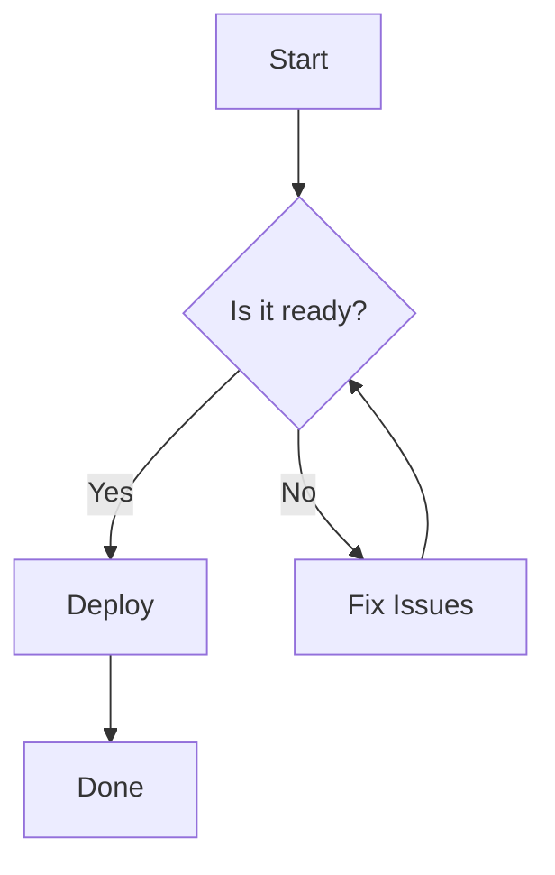
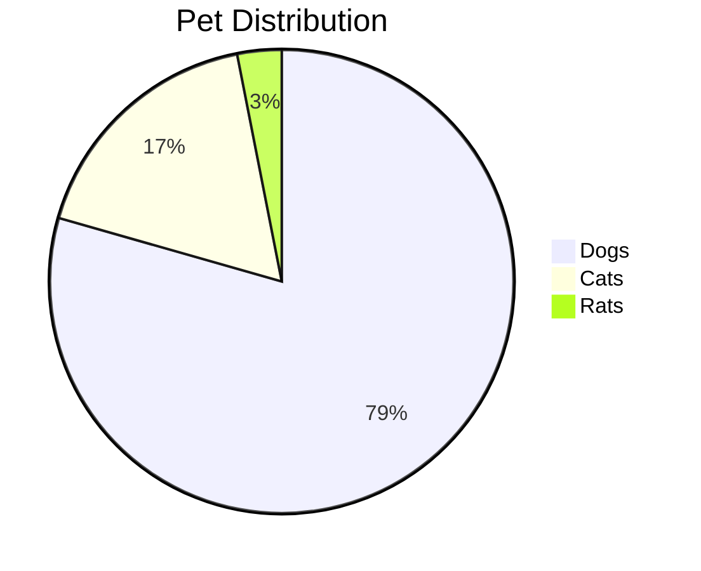

# Mermaid Diagrams Guide

Create charts and diagrams in Markdown using [Mermaid](https://mermaid.js.org/) syntax.

## Supported Diagram Types

- **Flowcharts**: `graph`, `flowchart`
- **Sequence Diagrams**: `sequenceDiagram`
- **Class Diagrams**: `classDiagram`
- **State Diagrams**: `stateDiagram`
- **Gantt Charts**: `gantt`
- **Pie Charts**: `pie`
- **Entity Relationship**: `erDiagram`
- **User Journey**: `journey`
- **Git Graph**: `gitGraph`

## Basic Usage

````markdown

````

## HTML Rendering

````swift
let markdown = """

"""

let parser = SwiftMarkdownParser()
let document = try parser.parse(markdown)
let html = try await HTMLRenderer().renderFragment(document)
````

## SwiftUI Integration

The native renderer shows an accessible source fallback by default. Supply a
`SwiftUIRichContentAdapter` when the application owns a visual Mermaid
implementation; its Mermaid request receives the configured
`MermaidConfiguration`. Return `nil` for requests that should keep their native
fallback.

```swift
import SwiftUI
import SwiftMarkdownParser

struct ContentView: View {
    let markdown = """
    # Document with Diagram

    ```mermaid
    graph LR
        A[Input] --> B[Process]
        B --> C[Output]
    ```
    """

    @State private var content: AnyView?

    var body: some View {
        Group {
            if let content = content {
                ScrollView {
                    content.padding()
                }
            } else {
                ProgressView("Loading...")
            }
        }
        .task {
            await loadContent()
        }
    }

    @MainActor
    private func loadContent() async {
        do {
            let parser = SwiftMarkdownParser()
            let ast = try parser.parse(markdown)
            let renderer = SwiftUIRenderer(options: SwiftUIRenderOptions(
                mermaidConfiguration: .default,
                richContentAdapter: SwiftUIRichContentAdapter { request in
                    guard case let .mermaid(node, configuration) = request else {
                        return nil
                    }
                    return AnyView(MyMermaidView(   // your view
                        source: node.content,
                        configuration: configuration
                    ))
                }
            ))
            self.content = try await renderer.render(ast)
        } catch {
            self.content = AnyView(Text("Error loading content"))
        }
    }
}
```

## Configuration

Diagrams are written in Mermaid syntax and drawn in the browser by
[Pele](https://github.com/obsidianmd/pele) 1.13.0, which the package bundles.

```swift
let config = MermaidConfiguration(
    assetSource: .bundled,
    theme: .init(
        background: "#0d1117",
        foreground: "#e6edf3",
        line: "#78a9ff",
        surface: "#161b22",
        accent: "#0a84ff",
        series: ["#4493f8", "#3fb950", "#d29922"]
    ),
    fontFamily: "\"Avenir Next\", sans-serif",
    zoom: .auto,
    messages: .localized(locale: Locale(identifier: "pt-BR"))
)

let document = try parser.parse(markdown)
let options = HTMLRenderOptions(mermaidConfiguration: config)
let html = try await HTMLRenderer(options: options).renderFragment(document)
```

`Theme` is projected onto the `--pele-*` custom properties (`--pele-bg`,
`--pele-fg`, `--pele-fg-on-dark`, `--pele-fg-on-light`, `--pele-line`,
`--pele-border`, `--pele-surface`, `--pele-surface-alt`, `--pele-muted`,
`--pele-accent`, `--pele-critical`, `--pele-error`, `--pele-series-1…12`) and
`fontFamily` onto `--pele-font`. Pele paints with these variables at paint
time, so changing them restyles a rendered diagram without rendering it again.
A value containing `;`, `{`, `}`, `<`, `>`, a backslash or a line break is
ignored. `customCSS` is trusted host CSS for anything else.

`zoom` is `.auto` (controls only when a diagram is scaled down), `.always`, or
`.disabled`. `fontSize` and `maxTextSize` (Pele's source `limit`) are passed to
`pele.mount`.

When Pele rejects a diagram, the diagram's container shows
`messages.diagramFailed` followed by the escaped source in a
`code.language-mermaid` block; Pele's own English message is never shown. The
default text comes from the package string catalog (`.localized(locale:)`);
a host can pass any string. Other diagrams in the document still render and
the readiness report stays `ready`.

`assetSource` accepts `.bundled`, `.cdn(version:)` (loads
`pele@<version>/dist/pele.global.js` from jsDelivr), or `.custom(scriptURL:)`.
Bundled mode inlines the runtime and works without network access. Diagram
source is HTML-escaped before entering the DOM and is read back as text;
Pele does not accept HTML labels. Configuration is encoded by the browser
assembler and never emits caller values as executable JavaScript.

Complete documents include the `mermaid` feature in the versioned browser-runtime
report's `requiredFeatures`. If the Pele asset or its initialization fails, `failedFeatures`
contains `mermaid`; mixed failures name every identified failed feature. The
report describes runtime state only. Host applications remain responsible for
whether that state completes, falls back, or rejects an artifact.
