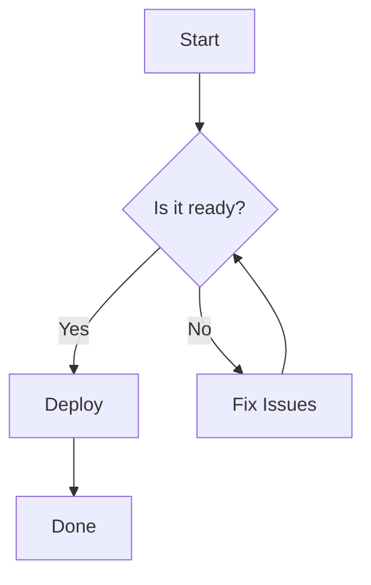
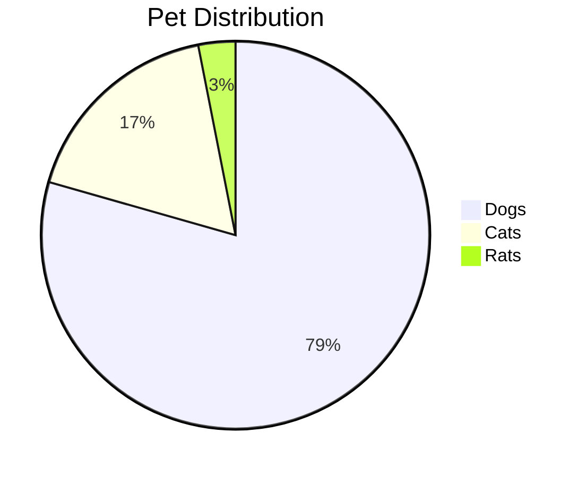

# Mermaid Diagrams Guide

Create interactive charts and diagrams in Markdown using [Mermaid](https://mermaid.js.org/) syntax.

## Supported Diagram Types

- **Flowcharts**: `graph`, `flowchart`
- **Sequence Diagrams**: `sequenceDiagram`
- **Class Diagrams**: `classDiagram`
- **State Diagrams**: `stateDiagram`
- **Gantt Charts**: `gantt`
- **Pie Charts**: `pie`
- **Entity Relationship**: `erDiagram`
- **User Journey**: `journey`
- **Git Graph**: `gitGraph`

## Basic Usage

````markdown

````

## HTML Rendering

````swift
let markdown = """

"""

let parser = SwiftMarkdownParser()
let document = try parser.parse(markdown)
let html = try await HTMLRenderer().renderFragment(document)
````

## SwiftUI Integration

```swift
import SwiftUI
import SwiftMarkdownParser

struct ContentView: View {
    let markdown = """
    # Document with Diagram

    ```mermaid
    graph LR
        A[Input] --> B[Process]
        B --> C[Output]
    ```
    """

    @State private var content: AnyView?

    var body: some View {
        Group {
            if let content = content {
                ScrollView {
                    content.padding()
                }
            } else {
                ProgressView("Loading...")
            }
        }
        .task {
            await loadContent()
        }
    }

    @MainActor
    private func loadContent() async {
        do {
            let parser = SwiftMarkdownParser()
            let ast = try parser.parse(markdown)
            let renderer = SwiftUIRenderer()
            self.content = try await renderer.render(ast)
        } catch {
            self.content = AnyView(Text("Error loading content"))
        }
    }
}
```

## Configuration

```swift
// Custom Mermaid themes and settings
let config = MermaidConfiguration(
    assetSource: .bundled,
    theme: .dark,
    securityLevel: .strict
)

let document = try parser.parse(markdown)
let options = HTMLRenderOptions(mermaidConfiguration: config)
let html = try await HTMLRenderer(options: options).renderFragment(document)
```

`assetSource` accepts `.bundled`, `.cdn(version:)`, or
`.custom(scriptURL:)`. Bundled mode inlines the pinned Mermaid runtime and
works without network access. Diagram source is HTML-escaped before entering
the DOM; Mermaid receives the original text through the `<pre>` element.
