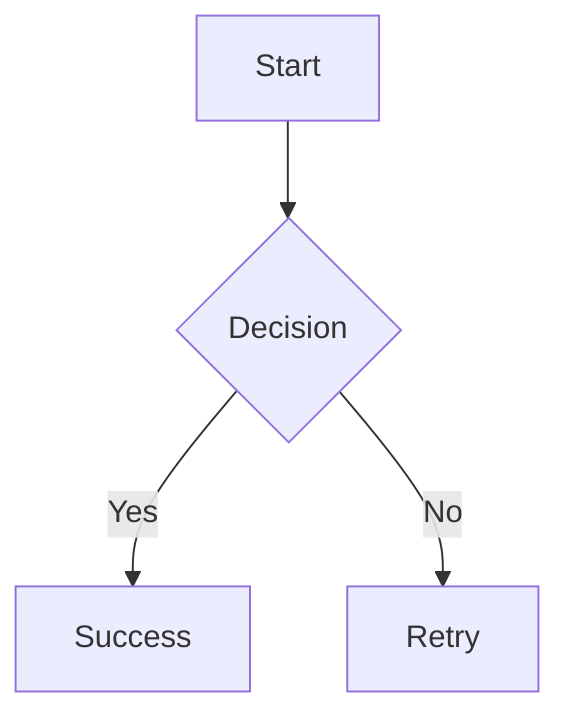

# SwiftMarkdownParser

[](https://github.com/sciasxp/SwiftMarkdownParser/actions/workflows/ci.yml)
[](https://swift.org)
[](https://developer.apple.com/ios/)
[](https://developer.apple.com/macos/)
[](https://swift.org/package-manager/)
[](https://opensource.org/licenses/MIT)

A Swift-native Markdown parser with AST generation, HTML rendering, and SwiftUI support. Built for Swift 6 with async/await and zero dependencies.

## Features

- **CommonMark 0.30** syntax with **GitHub Flavored Markdown** extensions (see [Known Limitations](#known-limitations))
- **HTML rendering** with cached syntax highlighting for 6 built-in programming languages
- **SwiftUI rendering** for native iOS/macOS apps (requires iOS 17.0+/macOS 14.0+)
- **AST generation** for custom processing and analysis
- **Zero dependencies** - pure Swift implementation
- **Async/await** support with Swift 6 concurrency
- **Mermaid diagram** support in HTML plus SwiftUI host adapters and source fallback
- **KaTeX math** rendering for inline and display math expressions

## Requirements

- **Swift 6.4+** (Xcode 27 beta or a compatible Swift toolchain)
- **iOS 17.0+**
- **macOS 14.0+**

## Installation

Add to your `Package.swift`:

```swift
dependencies: [
    .package(url: "https://github.com/sciasxp/SwiftMarkdownParser.git", branch: "main")
]
```

## Quick Start

### HTML Rendering

````swift
import SwiftMarkdownParser

let markdown = """
# Hello World
This is **bold** and *italic* text with a [link](https://swift.org).

- [x] Completed task
- [ ] Pending task

```swift
print("Hello, World!")
```
"""

let parser = SwiftMarkdownParser()
let document = try parser.parse(markdown)
let html = try await HTMLRenderer().renderFragment(document)
print(html)
````

### SwiftUI Integration

```swift
import SwiftUI
import SwiftMarkdownParser

struct MarkdownView: View {
    let markdown: String
    @State private var renderedView: AnyView?

    var body: some View {
        Group {
            if let view = renderedView {
                view
            } else {
                ProgressView("Loading...")
            }
        }
        .task {
            await renderMarkdown()
        }
    }

    @MainActor
    private func renderMarkdown() async {
        do {
            let parser = SwiftMarkdownParser()
            let ast = try parser.parse(markdown)

            let renderer = SwiftUIRenderer()
            renderedView = try await renderer.render(ast)
        } catch {
            renderedView = AnyView(Text("Error: \(error.localizedDescription)"))
        }
    }
}
```

### Working with the AST

```swift
import SwiftMarkdownParser

let parser = SwiftMarkdownParser()
let document = try parser.parse(markdown)

// Analyze the complete AST in stable depth-first order.
for visit in document.depthFirst() {
    switch visit.node {
    case let heading as AST.HeadingNode:
        print("Heading Level \(heading.level)")
    case let link as AST.LinkNode:
        print("Link to: \(link.url)")
    case let codeBlock as AST.CodeBlockNode:
        print("Code block (\(codeBlock.language ?? "plain"))")
    case let table as AST.GFMTableNode:
        print("Table with \(table.rows.count) rows")
    default:
        break
    }
}
```

Rewrite a document immutably with one bottom-up pass:

```swift
let rewritten = try document.rewriting { visit in
    guard let link = visit.node as? AST.LinkNode else { return .keep }
    return .replace(AST.LinkNode(
        url: "https://new.example",
        title: link.title,
        children: link.children,
        sourceLocation: link.sourceLocation
    ))
}
```

Rules may keep, remove, replace, or expand nodes. Replacements are not revisited
in the same pass.

### Syntax Highlighting

HTML renderer includes syntax highlighting for JavaScript, TypeScript, Swift,
Kotlin, Python, and Bash. One `SyntaxHighlighter` owns aliases, support
discovery, validation, fallback, and bounded caching:

````swift
let codeMarkdown = """
```swift
let parser = SwiftMarkdownParser()
let document = try parser.parse("# Hello")
let html = try await HTMLRenderer().renderFragment(document)
```
"""

let parser = SwiftMarkdownParser()
let document = try parser.parse(codeMarkdown)
let options = HTMLRenderOptions(
    styleConfiguration: HTMLStyleConfiguration(
        syntaxHighlighting: HTMLSyntaxHighlightingOptions(enabled: true)
    )
)
let html = try await HTMLRenderer(options: options).renderFragment(document)
// Returns HTML with syntax highlighting applied
````

Use the semantic highlighting module directly when the presentation is not
HTML:

```swift
let highlighter = SyntaxHighlighter()
let supportedLanguages = await highlighter.supportedLanguages
let tokens = await highlighter.highlight(
    "let answer = 42",
    language: "swift"
)
```

Unsupported languages and highlighting failures return `nil`, allowing callers
to preserve the original source as plain text.

### Deterministic Resource Limits

```swift
let limits = SwiftMarkdownParser.ResourceLimits(
    maximumSourceLength: 2_000_000,
    maximumNestingDepth: 100,
    maximumWork: 25_000_000
)

let parser = SwiftMarkdownParser(resourceLimits: limits)
```

The Supported Dialect is fixed: CommonMark 0.30, GFM, math, and Mermaid are
always recognized. Every parser-produced node includes a precise source range.

### Mermaid Diagrams

HTML renders Mermaid through the configured browser runtime. Native SwiftUI
preserves a readable source fallback and can delegate visual rendering through
one `SwiftUIRichContentAdapter`:

````swift
let diagramMarkdown = """

"""

let parser = SwiftMarkdownParser()
let document = try parser.parse(diagramMarkdown)
let html = try await HTMLRenderer().renderFragment(document)
// HTML output includes embedded Mermaid diagram

let nativeOptions = SwiftUIRenderOptions(
    richContentAdapter: SwiftUIRichContentAdapter { request in
        guard case let .mermaid(node, configuration) = request else {
            return nil
        }
        return AnyView(MyMermaidView(
            source: node.content,
            configuration: configuration
        ))
    }
)
let nativeView = try await SwiftUIRenderer(options: nativeOptions).render(document)
````

Native SwiftUI fallback titles, errors, and VoiceOver semantics are localized
from the package bundle in English and Brazilian Portuguese. Markdown source
and document-provided identifiers remain verbatim values rather than
localization keys.

## Architecture

All public work crosses a small set of document-level interfaces:

```text
Markdown Source -> SwiftMarkdownParser.parse(_:) -> AST.DocumentNode
                                                    |-> depthFirst() / rewriting(_:)
                                                    |-> HTMLRenderer
                                                    `-> SwiftUIRenderer

HTMLRenderer output -> MarkdownWebView (macOS only)
```

Parsing constructs one complete semantic document. Traversal and rewriting
operate on that document, while each output-specific renderer owns its own
presentation rules. HTML rendering additionally centralizes browser feature
discovery and asset assembly; syntax highlighting is a separate semantic module
used by its code-block renderer.

See the [Architecture Guide](Docs/Architecture.md) for module ownership,
extension rules, source layout, and decision records.

## Public Interface Reference

### Core Types

- `SwiftMarkdownParser` - Main parser class
- `SwiftMarkdownParser.ResourceLimits` - Deterministic source, nesting, and work limits
- `HTMLRenderer` - Renders AST to HTML with syntax highlighting
- `SwiftUIRenderer` - Renders AST to SwiftUI views (iOS 17.0+/macOS 14.0+)
- `SyntaxHighlighter` - Produces validated semantic code tokens with built-in aliases and caching
- `MarkdownWebView` - Presents a document as HTML in WebKit (macOS 14.0+ only; not available on iOS)

### Main Methods

```swift
// Build a complete Markdown Document synchronously
func parse(_ markdown: String) throws -> AST.DocumentNode

// Render an embeddable HTML fragment
func renderFragment(_ document: AST.DocumentNode) async throws -> String

// Render a complete HTML document
func renderDocument(
    _ document: AST.DocumentNode,
    metadata: HTMLDocumentMetadata = .init()
) async throws -> String

// Render a native SwiftUI view on MainActor
@MainActor func render(_ document: AST.DocumentNode) async throws -> AnyView

// Discover and use built-in semantic syntax highlighting
let highlighter = SyntaxHighlighter()
let supportedLanguages = await highlighter.supportedLanguages
let tokens = await highlighter.highlight(code, language: "swift")
```

## Known Limitations

The parser targets CommonMark 0.30 and GFM syntax but is not fully conformant
with the CommonMark specification:

- **HTML entity and numeric character references are not decoded.** Sequences
  such as `&amp;`, `&copy;`, or `&#35;` are recognized but kept as literal text
  in the AST and in rendered output instead of being replaced by the characters
  they represent.

`MarkdownWebView` is available on macOS only; on iOS, present `HTMLRenderer`
output in your own web view or use `SwiftUIRenderer`.

## Documentation

- [Architecture Guide](Docs/Architecture.md) — public seams, module ownership, extension rules, and ADR index
- [HTML Renderer Guide](Docs/HTMLRenderer.md) — HTML output with syntax highlighting and theming
- [SwiftUI Renderer Guide](Docs/SwiftUIRenderer.md) — native SwiftUI rendering
- [Syntax Highlighting Guide](Docs/SyntaxHighlighting.md) — code syntax highlighting details
- [Parser Usage Guide](Docs/ParserUsage.md) — AST generation and custom processing
- [Mermaid Diagrams Guide](Docs/MermaidUsage.md) — interactive chart and diagram support
- [KaTeX Math Guide](Docs/KaTeXUsage.md) — math expression rendering
- See [`Examples/`](Examples/) directory for complete working examples
- Check [`Tests/`](Tests/) directory for comprehensive usage patterns
- Review [`CONTRIBUTING.md`](CONTRIBUTING.md) for development guidelines

## Testing

```bash
swift test
```

## Contributing

1. Fork the repository
2. Create a feature branch
3. Make your changes and add tests
4. Submit a pull request

## License

MIT License - see [LICENSE](LICENSE) file for details.
